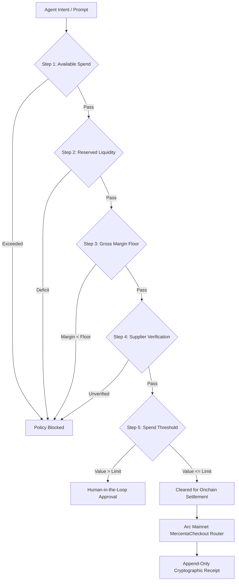

# Mercenta — Deterministic Commerce & Policy Engine for Autonomous Agents on Arc

<div align="center">
  
  
  
  
  
  
</div>

<br />

> **Production Status:** The **MercentaCheckout** routing gateway is deployed, verified, and unpaused on **Arc Mainnet (Chain ID 5042)**. Autonomous agents and web users execute real digital-service purchases with native 6-decimal USDC settlement and sub-second Malachite block finality.

---

## ⚡ Live Deployments & On-Chain Verifications

| Resource | Network / Target | URL / Address |
| --- | --- | --- |
| **Flagship Portal** | Production Web | [mercenta.xyz](https://mercenta.xyz) |
| **Mainnet Console** | Arc Mainnet (5042) | [mainnet.mercenta.xyz/app](https://mainnet.mercenta.xyz/app) |
| **MercentaCheckout Router** | Arc Mainnet Contract | [`0x06b67adf8d63c8c35a6beda42a3bb93d485af3ed`](https://explorer.arc.io/address/0x06b67adf8d63c8c35a6beda42a3bb93d485af3ed#code) |
| **Merchant Settlement Vault** | Arc Mainnet Recipient | [`0x58863e4a739da0e62c2eba258b7783e95d5c48ce`](https://explorer.arc.io/address/0x58863e4a739da0e62c2eba258b7783e95d5c48ce) |
| **Native USDC (Arc)** | Canonical ERC-20 (6 dec) | [`0x3600000000000000000000000000000000000000`](https://explorer.arc.io/token/0x3600000000000000000000000000000000000000) |
| **Verified Purchase Tx #1** | Live Buyer (Telegram Stars) | [`0xaefe4925...`](https://explorer.arc.io/tx/0xaefe4925e07a38981b2382e75e1f0e427774d6c6e737c35fa9ea7713d09a2500) |
| **Verified Purchase Tx #2** | Live Buyer (Telegram Stars) | [`0xcf322d7d...`](https://explorer.arc.io/tx/0xcf322d7d8e20e36b8568ec9c4aee46062a4f4efb8e4544c4fae857e3f898a395) |
| **Verified Purchase Tx #3** | Live Buyer (Apple Gift Card) | [`0xa5d03fd9...`](https://explorer.arc.io/tx/0xa5d03fd9ea67e3bf5d4e1d1ebefbf79060b2ebdf254b1f486fc7f79430c5e7b2) |
| **Developer API / Swagger** | REST & OpenAPI Specs | [mainnet.mercenta.xyz/api-docs](https://mainnet.mercenta.xyz/api-docs) |
| **Testnet Sandbox** | Arc Testnet (5042002) | [testnet.mercenta.xyz/app](https://testnet.mercenta.xyz/app) |

---

## 🛡️ The Core Problem: Why LLMs Must Never Hold the Treasury Pen

Autonomous AI agents are increasingly tasked with procurement: acquiring API credit pools, purchasing on-demand GPU compute hours, and provisioning software licenses.

However, equipping a probabilistic Large Language Model with direct signing keys over an on-chain treasury introduces critical enterprise vulnerabilities:
1. **Prompt Injections & Sybil Draining:** Adversarial inputs or poisoned web scraping feeds can trick an LLM into signing inflated purchase orders or transferring capital to unauthorized addresses.
2. **The Negative Margin Trap:** An agent reselling services can miscalculate dynamic supplier rates or currency fees, draining company capital at a net loss.
3. **The Finance Reconciliation Nightmare:** Ordinary crypto transfers lack durable records linking model intent, policy rules evaluated, approval thresholds, and verifiable deliverable receipts.

### The Mercenta Paradigm
$$\text{Propose} \longrightarrow \text{Check} \longrightarrow \text{Authorise} \longrightarrow \text{Settle}$$

> **"A model proposes — it never authorises."**  
> The AI agent suggests what to buy; an immutable, deterministic policy engine decides whether execution is permitted; settlement and fulfillment are written to a single append-only receipt.

---

## ⚙️ Architecture: The 5-Step Deterministic Policy Gate

Every agent purchase intent is routed through an immutable 5-step evaluation sequence before funds can ever be debited or orders placed:



### The 5 Checks:
1. **Available to Spend Check:**
   $$\text{orderAmount} \le \text{availableToSpend}$$
   Validates that the requested order fits within the organization's published liquid spending allowance.
2. **Reserved Liquidity Check:**
   $$\text{supplierCost} \le (\text{totalBalance} - \text{reservedLiquidity})$$
   Guarantees that essential operating liquidity and locked obligations remain protected.
3. **Gross Margin Floor Enforcement:**
   $$\text{grossMargin} = \frac{\text{orderValue} - \text{supplierCost}}{\text{orderValue}} \ge \text{grossMarginFloor} \quad (\text{e.g. } \ge 15.0\%)$$
   Hard mathematical barrier against negative margins or hallucinated discount rates.
4. **Supplier Verification:**
   Validates that the digital catalog provider is verified, pricing is unexpired, and SLA availability is confirmed.
5. **Auto-Approval Threshold:**
   $$\text{orderValue} \le \text{autoApprovalLimit} \quad (\text{e.g. } \le 5,000.00\text{ USDC})$$
   If the value exceeds the threshold, execution pauses into an immutable human-in-the-loop review queue.

---

## 🏛️ Smart Contract Engineering (Arc Mainnet)

### MercentaCheckout Router
The core router on Arc Mainnet handles atomic clearing:
- **Exact 6-Decimal USDC Transfers:** Direct interaction with Arc's native USDC contract (`0x3600...0000`).
- **Configurable Platform Fee Splits:** Deterministic basis-point fees directed to treasury, with the principal routed to the supplier vault in a single atomic transaction.
- **Circuit Breaker:** Hardware-grade `pause` and `unpause` emergency mechanisms.
- **Append-Only Events:** Emits `OrderPlaced(bytes32 orderId, address buyer, uint256 amountUsdc, string ref)` for instant finance reconciliation.

```solidity
// Verified on Arc Mainnet: 0x06b67adf8d63c8c35a6beda42a3bb93d485af3ed
function checkout(
    bytes32 orderId,
    uint256 amountUsdc,
    string calldata productRef
) external nonReentrant whenNotPaused {
    require(amountUsdc > 0, "INVALID_AMOUNT");
    require(!processedOrders[orderId], "DUPLICATE_ORDER");

    processedOrders[orderId] = true;
    usdc.safeTransferFrom(msg.sender, merchantTreasury, amountUsdc);

    emit OrderPlaced(orderId, msg.sender, amountUsdc, productRef);
}
```

---

## 🔵 Circle Agent Stack & x402 Micropayments

Mercenta incorporates the **Circle Agent Stack** across three distinct operational layers:
1. **Circle Gateway x402 Nanopayments:** Express middleware (`createGatewayMiddleware`) and client (`GatewayClient.pay()`) for sub-cent API billing and agent-to-agent data queries.
2. **Cross-Chain Liquidity:** CCTP V2 integration for seamless cross-chain capital ingestion from Ethereum Sepolia directly into Arc USDC.
3. **Developer-Controlled Agent Wallets:** Programmatic 2-of-2 MPC agent wallets enabling autonomous agents to execute pre-approved orders without storing private keys in server memory.

---

## 🏆 Tameion Hackathon Track Alignment

Mercenta directly addresses **RFB 04: Autonomous Business Operator** from the Canteen Tameion Hackathon:
> *"An agent that pays for services on its own authority should know what it bought, enforce limits, verify deliveries, and settle on Arc in USDC."*

- **Autonomous Procurement:** AI agents browse live digital services (compute, token pools, gaming keys, platform subscriptions).
- **Hard Spend & Margin Boundaries:** 5-step deterministic engine protects treasuries against model mistakes.
- **Real Production Traction:** Live on-chain orders settled on Arc Mainnet with real users, verified tx hashes, and instantaneous digital delivery.

---

## 🛠️ Local Development & Testing

### Prerequisites
- Node.js >= 22 (recommended Node 24)
- Foundry (`forge`, `cast`)

### Installation & Build

```bash
# Clone the repository
git clone https://github.com/rdmbtc/mercenta.git
cd mercenta

# Run frontend tests
cd web
npm ci
npm test

# Build production bundle
npm run build
```

---

<div align="center">
  <i>Built with ❤️ for the Arc Open Source Showcase · Tameion Hackathon</i>
</div>
