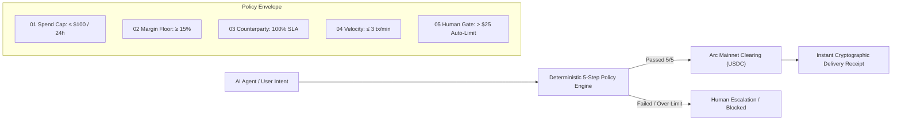

# Mercenta — Autonomous B2B Digital Procurement Protocol on Arc

> **Deterministic Policy Boundary Between AI Intent and Onchain Settlement**  
> *Built for the Tameion Agents Hackathon (Arc Blockchain · Circle Stack)*

[](https://github.com/rdmbtc/mercenta)
[-00d2ff?style=flat-square)](https://explorer.arc.io)
[](https://www.circle.com)
[](LICENSE)

---

## 1. Executive Summary

Mercenta is an **Autonomous Business Operator and Procurement Gateway** designed for digital agencies, AI startups, and autonomous agents operating on the Arc blockchain. 

When businesses delegate spending to AI agents, giving them unconstrained corporate cards or raw private keys creates existential risks: runaway API loops, prompt injection, and unauthorized treasury drainage. Mercenta solves this with a **Deterministic 5-Step Policy Engine** (Rubicon architecture standard) that sits as an unbypassable mathematical gate between model intent and financial execution.



---

## 2. Live Ecosystem Deployments

- **Mainnet Hub & Business Operator:** [https://mainnet.mercenta.xyz](https://mainnet.mercenta.xyz)
- **Testnet Autonomous Operator Lab:** [https://testnet.mercenta.xyz/app?section=agent-chat](https://testnet.mercenta.xyz/app?section=agent-chat)
- **Flagship Presentation:** [https://mercenta.xyz](https://mercenta.xyz)
- **Developer Documentation:** [https://docs.mercenta.xyz](https://docs.mercenta.xyz)
- **System Status & Telemetry:** [https://status.mercenta.xyz](https://status.mercenta.xyz)

---

## 3. The 5-Step Policy Engine (Rubicon Standard)

Every purchase request—whether triggered by a conversational copilot, an autonomous cron trigger, or an API key—must pass five independent, non-LLM mathematical checks before funds can move:

| Gate | Name | Boundary | Purpose |
| :---: | :--- | :--- | :--- |
| **01** | **Spend Cap** | `≤ 100.00 USDC / 24h` | Hard ceiling on daily outlays per wallet; prevents runaway spending loops. |
| **02** | **Margin Floor** | `≥ 15.0% Gross Margin` | Rejects unfavorable wholesale pricing; guarantees positive business unit economics. |
| **03** | **Counterparty SLA** | `100% Verified SLAs` | Routes orders strictly through vetted institutional suppliers with guaranteed activation. |
| **04** | **Velocity Cap** | `≤ 3 orders / min` | Throttles high-frequency bursts and malicious automated replay attempts. |
| **05** | **Human Gate** | `> $25.00 USDC Escalation` | Any transaction exceeding the auto-approval ceiling pauses for an explicit 1-click human signature. |

---

## 4. Deep Circle Stack Integration

Mercenta leverages the full suite of Circle financial infrastructure:

1. **Circle Onramp Kit 1.0.3**:
   - Embedded directly into the workspace (`Add USDC`).
   - Supports **BVNK Bank Transfers** (no KYB required) and **Transak Cards / Apple Pay / Google Pay**.
   - Strict server-side session minting and cryptographic wallet binding; payment credentials never touch client storage.
2. **Circle Agent Stack & x402 Micropayments**:
   - HTTP `402 Payment Required` gateway for autonomous machine-to-machine transactions.
   - Micro-metered paid agent reports and real-time execution verification.
3. **Native Arc USDC Settlement**:
   - Settlements clear natively in USDC on Arc Mainnet (Chain ID `5042`) with sub-second finality and near-zero gas costs.

---

## 5. Smart Contracts & Onchain Architecture

| Entity | Address | Network | Explorer |
| :--- | :--- | :---: | :--- |
| **Policy Router Reference** | `0x06b67adf8d63c8c35a6beda42a3bb93d485af3ed` | Arc Mainnet (5042) | [View Code](https://explorer.arc.io/address/0x06b67adf8d63c8c35a6beda42a3bb93d485af3ed#code) |
| **Clearing Gateway** | `0x58863e4a739da0e62c2eba258b7783e95d5c48ce` | Arc Mainnet (5042) | [View Address](https://explorer.arc.io/address/0x58863e4a739da0e62c2eba258b7783e95d5c48ce) |
| **Arc Native USDC** | `0x3600000000000000000000000000000000000000` | Arc Mainnet (5042) | [View Token](https://explorer.arc.io/token/0x3600000000000000000000000000000000000000) |
| **Testnet Settlement Vault** | `0x486b1f28b7e2832810a08e1ecfa732e752945d7f` | Arc Testnet (5042002) | [View Vault](https://testnet.arcscan.app/address/0x486b1f28b7e2832810a08e1ecfa732e752945d7f) |

---

## 6. Local Development & Verification

### Prerequisites
- Node.js >= 20.x (Node 24 recommended)
- npm or pnpm

### Setup
```bash
git clone https://github.com/rdmbtc/mercenta.git
cd mercenta/web
npm install
```

### Run Test Suite (80 Suites / 629 Tests)
```bash
npm test
```

### Build Production Bundle
```bash
npm run build
```

---

## 7. Security & Privacy Guarantees

- **Hardware/State-Machine Isolation**: LLMs are never granted write access to private keys or direct ERC-20 transfer methods.
- **Cryptographic Receipts**: Every cleared order produces a deterministic `reasonHash` binding the intent, 5 policy outcomes, onchain transaction hash, and supplier delivery evidence into an immutable audit record.
- **Non-Custodial Architecture**: Deposits and transfers require explicit user wallet confirmation; Mercenta does not pool or custody customer private funds.

---

## 8. License

MIT © 2026 Mercenta Protocol Contributors.
